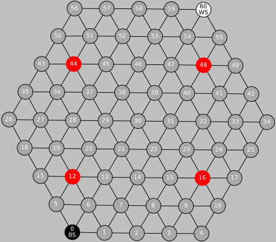
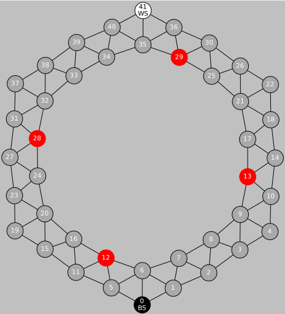
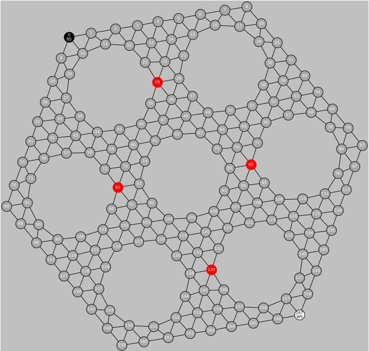

# Coursidor — serveur de jeu et joueurs IA pour un jeu de plateau inspiré de Quoridor, en C

*[English version](README.md)*

**Coursidor** est une variante de *Quoridor* qui se joue sur des graphes : deux joueurs font la course pour visiter un ensemble d'objectifs puis revenir, et peuvent poser des murs qui coupent des arêtes pour ralentir l'adversaire.
Ce projet implémente le **serveur de jeu**, les **plateaux** (sous forme de graphes creux) et plusieurs **joueurs IA**, chargés à l'exécution comme bibliothèques dynamiques.

<p align="center">
  
  
  
</p>
<p align="center"><em>Les trois types de plateaux : triangulaire, circulaire et troué (en rouge, les objectifs).</em></p>

## Fonctionnalités

- **Serveur de jeu** qui charge deux joueurs avec `dlopen`, fait respecter les règles, enchaîne des séries de parties et exporte chaque coup au format DOT de Graphviz
- **Plateaux** générés par programme (triangulaire, circulaire, troué) et stockés comme matrices d'adjacence creuses avec la GNU Scientific Library (format CSR)
- **Joueurs IA**, chacun compilé comme plug-in `.so` :
  - `yani` : **minimax avec élagage alpha-bêta** sur des états de jeu simulés ; la fonction d'évaluation est la différence entre les plus courtes tournées restantes des deux joueurs, calculées par un parcours en largeur sur les états *(position, direction, objectifs visités)* (un petit problème de voyageur de commerce)
  - `tristan` : joueur glouton qui choisit le coup qui maximise son avance en distance (BFS) sur l'adversaire
  - `steven` : joueur naïf qui a servi à tester le serveur
- **Visualisation** : chaque partie peut être rendue en PDF de plusieurs pages (une page par coup) avec `neato`
- **Tests** avec couverture `gcov`, et un rapport LaTeX (`report/`) contenant les preuves de correction et de complexité de la construction des plateaux

## Compilation et exécution

Prérequis : `gcc`, `make`, [GSL](https://www.gnu.org/software/gsl/) (`libgsl-dev`), et éventuellement Graphviz et `pdftk` pour la visualisation.

```bash
make GSL_PATH=/usr                     # compile install/server, install/yani.so, install/tristan.so
./install/server ./install/yani.so ./install/tristan.so -tH -m6 -g10
```

| Option | Signification |
|--------|---------------|
| `-t[T\|C\|H]` | type de plateau : triangulaire, circulaire, troué |
| `-m<n>` | taille du plateau |
| `-M<n>` | nombre maximal de tours |
| `-g<n>` | nombre de parties jouées à la suite |
| `-s<n>` | graine de l'aléatoire |
| `-p` | affiche chaque coup |

Afficher la dernière partie : `./src/generate-multi-graph.sh game.dot` (produit `output.pdf`).
Lancer les tests : `make test`.

## Structure du projet

```
src/
├── server.c                 Boucle de jeu, vérification des règles, export DOT
├── board.c, graph.h         Génération des plateaux (graphes creux avec GSL)
├── yani.c, opt.c, state.c   Joueur minimax / alpha-bêta et simulation des états de jeu
├── tsp.c, dijkstra.c        Plus courts chemins et tournées des objectifs
├── tristan.c, steven.c      Autres joueurs
test/                        Tests unitaires
report/                      Rapport LaTeX
```

## Contexte

Projet de programmation impérative à l'[ENSEIRB-MATMECA](https://enseirb-matmeca.bordeaux-inp.fr/) (Bordeaux INP), 1re année, 2024-2025.
Équipe : Lucie Pacou, Solan Boher-Sanchez, Tristan Collemiche, Yani Haouchine.
